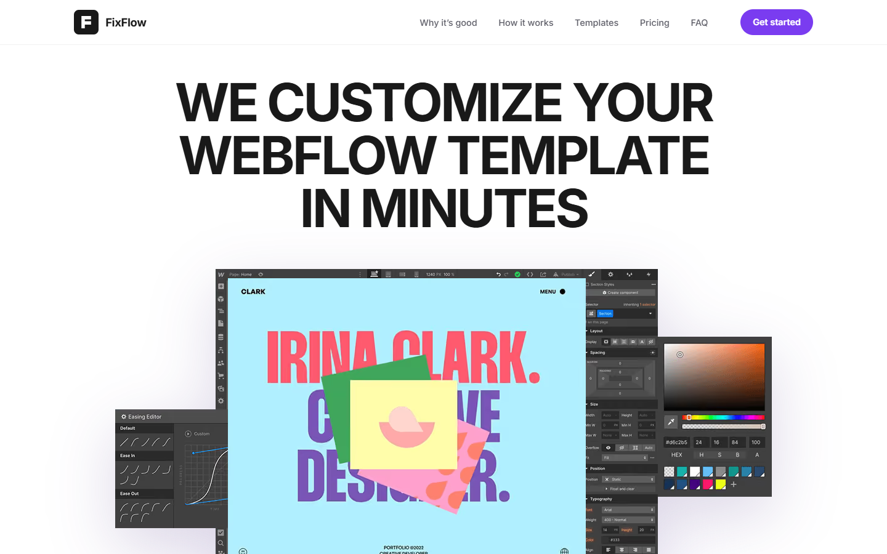
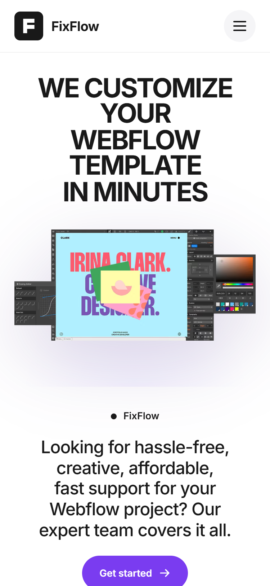

# FixFlow

A landing page for a team of Webflow experts who customize your Webflow template in days, not weeks.





**Live demo:** https://vovaddk.github.io/FixFlow/

Practice project — not affiliated with Webflow.

## Stack

- [Astro 7](https://astro.build) with TypeScript (strict)
- Scoped component CSS with design tokens as custom properties, no CSS framework
- `astro:assets` for responsive AVIF/WebP images and the Astro Fonts API for self-hosted Inter
- `@astrojs/sitemap`, ESLint (`eslint-plugin-astro`, `typescript-eslint`, jsx-a11y rules), Prettier
- Playwright + axe-core smoke tests, GitHub Actions for CI and GitHub Pages

## Features

- Oversized type and a looping “Webflow is easy” marquee as the page’s signature, paused on hover and static with reduced motion
- Sticky header with a mobile menu: `aria-expanded`, closes on Escape and on link click, focus returns to the toggle
- FAQ built on native `<details name>`: keyboard operable, one answer open at a time, no JavaScript
- Two pricing plans, a numbered “how it works” sequence and template cards that start a pre-filled email
- Skip link, landmarks, ordered headings, visible focus rings, WCAG AA colour contrast
- Title, description, canonical, Open Graph/Twitter cards, `ProfessionalService` and `FAQPage` JSON-LD, sitemap, robots.txt

## Project structure

```
src/
  components/   one component per section (Header, Hero, Intro, Marquee, Why,
                HowItWorks, Templates, Pricing, Faq, Footer) + Arrow icon
  data/faq.ts   FAQ content, shared by the accordion and the JSON-LD
  layouts/      BaseLayout: head, SEO tags, fonts, skip link
  styles/       global tokens, base styles, buttons
  assets/       source images, optimized at build time
public/         favicon, robots.txt, Open Graph image
tests/          Playwright smoke + accessibility tests
```

## Scripts

| Command           | What it does                                            |
| ----------------- | ------------------------------------------------------- |
| `npm run dev`     | Start the dev server                                    |
| `npm run build`   | Build the static site into `dist/`                      |
| `npm run preview` | Serve the built site                                    |
| `npm run check`   | Type-check `.astro` and `.ts` files                     |
| `npm run lint`    | ESLint + Prettier check                                 |
| `npm run format`  | Format everything with Prettier                         |
| `npm test`        | Build, serve and run the Playwright smoke and axe tests |

Locally the tests use the installed Google Chrome; CI installs Playwright’s Chromium.

## Notes

- The site is served from `/FixFlow/`, so every internal URL goes through `import.meta.env.BASE_URL`.
- Every push to `main` runs lint, type-check, build and tests (`ci.yml`) and deploys to GitHub Pages (`deploy.yml`). In the repository settings, set Pages → Source to “GitHub Actions”.
- Contact actions open an email to the address from the original design; the page itself sends nothing.
- The FAQ answers are new copy: the original layout only had the questions.
